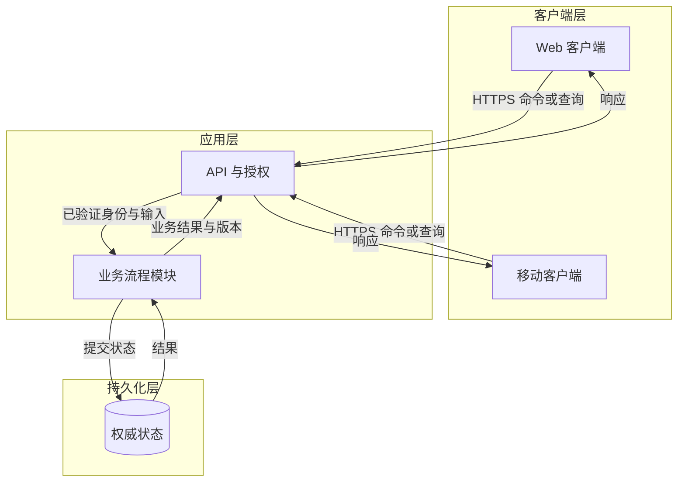
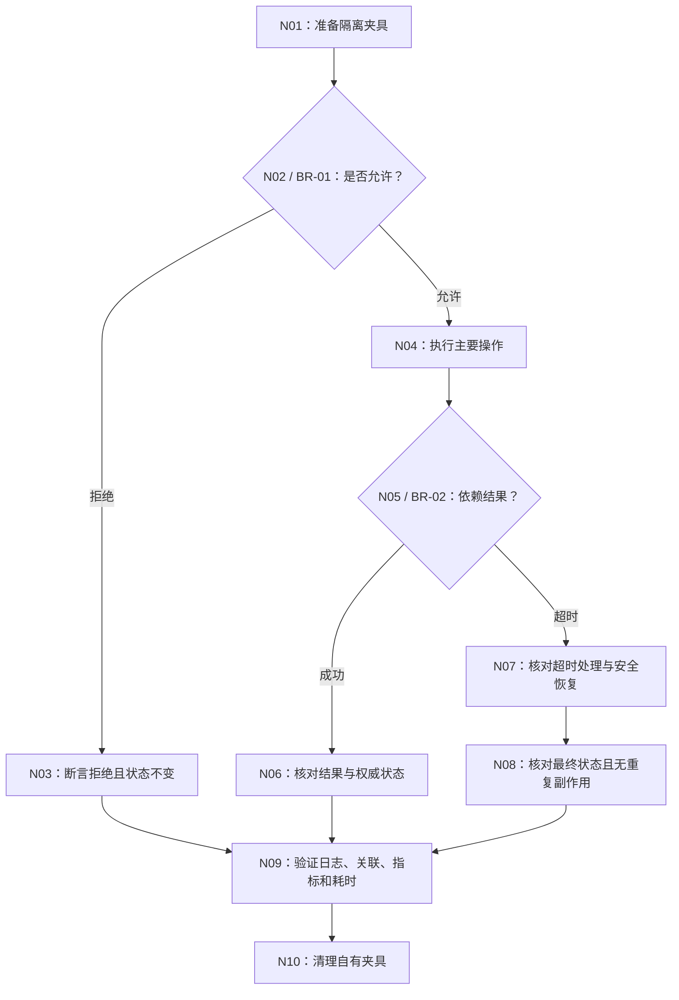

# 需求澄清、技术设计与 E2E 规划

开始澄清、设计或实质修订时阅读。所有规划内容放在一个 `spec.md` 中，
使用中文章节、说明、图节点与分支标签，保留三个必需章节及共享编号。
纯 UI 遵循入口文件的例外：第三章使用“UI 验证”，不生成 E2E 计划或测试流程图。
上述文档要求是默认模式；用户明确选择跳过 spec 时，按下方轻量规划执行，
不创建 `spec.md` 或图表附件。

## spec 模式选择

默认使用 spec 模式，不主动询问是否跳过。只有用户明确表达不需要 spec 或等价意图时，
才对当前任务切换到跳过模式；改动规模、紧急程度、需求清晰度和普通实现请求都不能代替选择。
若用户在流程中途选择跳过，停止新增或扩写 spec 产物，保留已经存在的文件，
除非用户另行要求处理；不要擅自删除已完成工作。适用的既有 spec 和仓库合同仍然有效。

跳过模式仍先了解项目和澄清真实缺口，然后在对话中确认轻量执行基线：

- 目标、范围内外和可观察验收。
- 关键技术边界、应复用的现有模式及会影响正确性的决定。
- 与风险相称的测试、E2E、UI 检查、日志或性能验证。
- 未决事项、授权范围及完成条件。

用户已明确给出某项内容时直接复用，不机械逐项复述或索取确认。
基线足以安全实现即可，不生成伪装成聊天消息的完整 spec，不要求 Mermaid 或 HTML。
关键歧义仍按每轮一个聚焦问题澄清；普通实现细节由执行者按项目模式决定。
范围、验收、架构边界或关键验证义务实质变化时，在对话中重新确认受影响部分。

## 默认 spec 生成的三个步骤

步骤一的 clarify 工作区选择入口同时适用于默认和跳过模式；
其余三步产物与文档关卡只适用于默认模式。

在本技能中使用 brainstorming 的协作方式，不依赖另一 skill、可视化伴侣服务，
也不切换到独立 writing-plans 流程。不复制其自动提交步骤，不拆成多份规划文档。

顺序为：

`明确需求 -> 确认技术方案 -> 构建 E2E 流程`

纯 UI 为 `明确需求（记录分类依据） -> 确认技术方案及 UI 验证清单 -> 整理 spec`。
混合改动仍对受影响业务链路规划 E2E，不因部分工作是样式调整而豁免整个任务。

每步都先了解背景、聚焦提问、呈现阶段产物，再与用户迭代到确认，随后推进。
复用已经明确的确认，不强迫用户对已确定内容重新完成三轮批准。
整理、自审和完整文档评审在三步之后进行，不能替代三步。

### 步骤一：明确需求

先选择工作区，再澄清功能需求。这属于步骤一内的准备，不是第四个核心步骤。

#### clarify 入口：询问新 worktree

具体需求提问或首次写规划文件之前，单独询问是否为本任务创建新 Git worktree，
不要与第一个需求问题合并。已有明确要求或拒绝时直接复用；同任务恢复或返回澄清时，
读取既有选择，不重复询问。

- **明确确认创建**：创建新的 worktree，不静默替换成既有 checkout。
  优先宿主的 worktree 创建/附加工具，否则按仓库支持的 Git 流程操作。
  检查 Git 状态，使用用户指定起点，未指定则用当前已提交 HEAD。
  说明未提交改动不会自动复制；若影响任务起点，创建前明确如何保留或纳入。
  不自动 stash、提交、reset 或移动无关改动。
- **拒绝或未明确确认**：留在当前工作区，不创建。
  一般的澄清、开发或技能更新请求不是创建确认。
- **当前不是 Git 仓库**：说明无法创建 Git worktree，不自动初始化仓库或宣称成功。
  用户要求隔离时，请其提供 Git 仓库或确认在原目录继续；否则保留原目录。

创建过程遵守仓库指令和宿主权限。等待异步创建/附加完成，核对返回路径，
后续读写、spec/HTML 生成及执行均显式使用该目录，并重新阅读所选 checkout 的适用指令。
创建失败时说明真实原因，解决问题或取得使用原工作区的许可；
用户要求隔离后不得静默回退。

在任务上下文或 Git 外的恢复记录中保存选择、原目录、新目录和起始 ref/SHA，
不把工作区或执行状态写入 spec 附录。
设计和实现持续使用选定工作区，除非用户改变选择。
以后清理 worktree 时保留必要产物。创建确认仅授权工作区准备；
默认模式的完整 spec 评审及开发、交付授权仍是独立关卡。
跳过模式没有文档评审关卡，但仍需明确实现与交付授权。

#### 澄清功能

先阅读项目现状并概述已知信息。判断是否为内聚 MVP 或多个独立系统；
范围较大时先讨论边界、依赖和阶段交付，再细化功能。
约定范围内保持一个 spec，不静默删减需求或按每个模块拆文档。

按问题对设计的影响选择下一问，不机械填问卷。根据需要明确用户和目标、
主流程、范围内外、验收、平台、数据所有权、外部依赖及运行约束。
每轮只问一个聚焦问题并等待真实回复，不附带多个无关问题或替用户作答。
简短例子可以帮助理解；只有宿主支持且允许时使用结构化选项，否则用单个普通文本问题。

在对话或草稿中区分已确认需求、用户决定、助手建议、假设和未决事项。
有意义的决定保留理由与来源/状态，可使用：

`D-ID | 主题 | 已选或建议方案 | 理由 | 确认状态或未决问题`

不将推荐方案记成用户已确认决定。
阶段产物是目标和需求章节：MVP 链路、范围、业务规则、约束及可观察的验收标准。
简要复述并获确认，重要意图或范围缺口解决后再选型。
可以先记录用户指定技术约束，但不要提前设计未明确的系统。

### 步骤二：确认技术方案

依据已确认需求与现有项目模式，对重要未决选型比较 2–3 个可行方案，先给推荐项。
讨论与本项目有关的用户行为、数据/调用流、一致性、开发成本、运维成本、
故障处理和现有技术兼容性。已固定技术或方式时确认其影响，不为凑选项重新选型。

分段呈现选型、模块/状态边界、架构与数据/调用流、重要接口合同及可观测性/性能设计。
按复杂度解释，较复杂方案分多轮确认。
仅同意某个框架或数据库，不等于批准完整架构。

图表用于帮助讨论架构或测试决定，草图本身不能证明假设已获认可。
模块应有清晰职责、状态所有权和可理解、可独立验证的接口；
沿用项目模式，不做无关重构。

阶段产物包括技术方案章节、已确认的重要决定，以及依照
[CLI 渲染规约](diagram-rendering.md) 生成的 `<feature-name>-dev-design.html`。
展示页面供评审，获确认后才构建 E2E 流程。普通实现细节不需要独立表决。
纯 UI 此时确认 UI 验证清单，随后直接整理 spec，不要求构建 E2E 流程。
设计中发现需求缺口时返回步骤一，不静默改变用户要求。

### 步骤三：构建 E2E 流程

同时使用前两步产物作为基线。依据实际架构，将 MVP 从初始动作/输入走到最终可观察结果。
识别关键条件及其有意义的结果，形成测试流程图、逐节点通过标准、
场景/需求映射、夹具和证据计划，遵循下方 E2E 章节合同。
包括核心调用日志、telemetry 检查及适用性能验证；本阶段不实现或运行产品测试。

分段讨论流程与验收，确认它能证明约定行为并覆盖高风险边界。
仅有测试名称列表不算完成产物。
阶段产物是 E2E 章节、可检查的节点/分支标准，以及用户确认的
`<feature-name>-test-workflow.html`；关键子流程放在同一页面。
因为行为或合同不清而无法确定期望结果时，返回步骤一或二，不提前宣布本步完成。

任何步骤的决定变化，都需复述变更并修订受影响的下游内容和确认；
保留不受影响的决定，不建立在矛盾假设上，也不把沉默当同意。
在任务上下文中简记当前步骤、确认产物和下一步；spec 草稿只保留设计决定及
与设计有关的未决问题，不为跟踪执行状态新增附录或规划文档。

## 整理与评审

本节及后续 spec 内容合同只适用于默认 spec 模式。
不规定最少讨论轮数。重要需求、选型与验证方式确认后，整理完整 spec。
草稿可随讨论演进，但未决内容必须标明，不得称为可批准方案或开始实现。
请求已经精确时，复用用户决定，只讨论真实缺口，简短确认可以足够。

检查占位内容、重要未决事项、矛盾、模糊标准、遗漏主流程和不必要范围。
涉及用户意图的歧义需回问，而不是擅自解释。完成下方就绪检查后，
提交完整书面 spec 供明确批准。对话中的分节确认不等于最终文档批准或执行授权。

## 目标和需求描述

包含目标、用户/平台、端到端 MVP 主流程、范围内外行为、假设和约束。
需求表可使用：

`REQ-ID | 验收标准 | 优先级 | 负责模块`

验收应描述外部可观察行为及失败结果。区分已约定 MVP 和延后改进，
不遗漏必需关键分支。

## 技术方案

必须包含：

- 重要选型：可行替代、选定方案、理由、成本/风险与既有系统兼容性；省略无关选型。
- 模块/层次表：职责、状态所有权、公开合同、允许依赖及现有/计划代码位置。
  只在架构上确有必要时列类或函数。
- 分层架构图和关键数据流。
- 跨边界合同，及适用的数据生命周期、认证/授权、一致性、超时、重试和重复处理语义。
- 核心链路日志、监控与性能方案。
- 交付切片、依赖顺序、必要的兼容/发布影响、风险，以及 spec 的 E2E 或 UI 验证章节引用。

建议简述关键通信协议和必要接口：调用方/被调用方、操作或事件、输入输出、
同步/异步模式及重要错误、超时、幂等语义。
进程内模块说明函数/服务合同，不凭空添加 HTTP 端点；
不穷举无关端点或内部 API。

未决事项需有负责人和解决动作。影响正确性、模块边界或验收的决定在批准前解决，
不以任意架构替代真实未决问题。

## 图表要求

同一 spec 的技术章节含架构图；非纯 UI 的 E2E 章节含测试流程图，使用 `mermaid` 代码块。
保存完全匹配的 `.mmd` 源码，按 [图表渲染规约](diagram-rendering.md) 用 CLI 生成两份 HTML，
对应章节嵌入链接，必要时插入 PNG。保留兼容的仓库图表约定；
不兼容时讨论解决方式，不静默取消 Mermaid 渲染。
纯 UI 仅生成开发设计 HTML，不生成测试流程源码、HTML 或 PNG。
跳过模式不生成 spec 图表、`.mmd`、HTML、PNG 或渲染元数据；
用户单独要求可视化时只生成其明确要求的产物，不将其视为 spec 批准关卡。

CLI 图与 HTML 是必需评审附件。依赖或浏览器不可用时保留草稿并报告阻塞；
未经用户明确接受限制，不将源码或人工语法检查当成已渲染完成。
检查真实结果的文字可读性、箭头、决策结果和裁切。

按有意义层次或部署边界分组，例如客户端、API/应用、领域/集成、持久化；
仅使用实际存在层次。保留少量承担职责的模块，图过拥挤时拆成总览和关键子图，
而不是组件清单。每个图节点都要对应已说明职责。

多端系统区分各客户端和服务端责任方。箭头明确请求/事件/数据含义与方向，
在图或邻近文字中说明协议、同步/异步、响应或事件返回路径及权威数据来源。
异步状态变化或多客户端同步不清晰时补时序图。

单端/进程内处理说明核心调用链、调用方向、传入/返回数据和状态所有权。
仅列模块没有关系不合格，不为模仿示例增加服务、客户端或协议。

下面只是结构示例，不是指定架构：

不要从示例推导实时更新、队列或独立后端需求。
获批功能存在事件通道或客户端同步时，明确呈现实际通道、传播和协调行为。

## 可观测性与性能合同

每条关键旅程都说明成功、失败和慢路径的可见性：

`旅程或 REQ | 边界/模块 | 结构化日志 | 指标/span | 告警或检查方式 | 性能预算 | 验证`

定义有用字段，例如关联/trace ID、操作、结果或错误类别、耗时和安全实体标识。
存在跨客户端、服务或异步任务边界时传递关联标识。
不记录密钥、原始个人信息、无限载荷，也不使用高基数指标标签。

给出具体计数器、延迟直方图、trace 或等价既有信号；
按部署实际选择请求率、错误率、延迟、积压或饱和度等指标，说明负责人和告警行动。
复用现有工具，区分“已埋点/已导出”与“仪表盘、告警真实可用”。
纯本地工具应解释生产告警不适用，并提供本地诊断，不能直接省略此项。

性能定义关键操作、测量边界、数据规模、并发、目标环境及适用的分位数、
吞吐/资源预算。建议值在获认可前标为建议；没有预算时测基线，不判为性能通过。
测量要有代表性，功能断言不是性能测试。

## E2E 测试方案

本节不适用于纯 UI；改用下方 UI 验证。用户明确要求或仓库强制的 E2E 仍须执行。

同时由用户旅程和高风险架构边界推导，不能只列页面或接口。
计划放在 spec 内，包含：

- 范围、对应 spec 版本、进入/退出条件、执行顺序和关键/非关键场景。
- 环境拓扑、工具/runner、夹具、隔离账号/数据、准备与清理、所需凭据及可复现命令。
- 真实依赖与 stub/mock 的边界，以及本地不能证明的内容。
  单元/集成测试只作辅助，不改名成真实 E2E。
- 场景表：`E2E-ID | REQ/BR 编号 | 准备/输入 | 操作 | 可观察断言 | 边界覆盖 | 优先级 | 证据`。
- 关键分支表：`BR-ID | 条件 | 有意义的结果 | 覆盖场景 | 理由`。
- 从初始输入/动作到最终结果的 MVP 测试图，含明确决策、结果路径、
  断言点和必要恢复/协调链路；不只展示测试 runner 或准备步骤。
- 逐节点通过标准，图内或表格中说明：
  `NODE-ID | 动作/条件 | 可观察通过标准 | E2E/REQ/BR 编号 | 证据`。
  图中出现的准备、决策、恢复、结果、telemetry 检查、清理节点都必须覆盖；
  决策说明各必需结果的预期路径与状态。
- 日志、监控、性能验证，以及适用的跨边界关联。
  建议核心调用检查结果/错误计数和延迟，定义字段、信号及其关联节点证据。
- 需求到计划测试的映射、计划覆盖范围与证据采集方法。
  实际执行状态、验证结果和证据位置写入 PR 简介，不写回 spec；
  尚无 PR 或仅本地交付时，按执行规约保留在任务上下文或 Git 外恢复记录中。

关键条件依实际产品而定：允许/拒绝、输入有效/无效、状态存在/缺失、
重复/冲突、依赖失败/超时、重试耗尽、部分完成、跨端一致性和恢复等。
选择影响正确性或风险的条件，覆盖每个所选条件的有意义结果，
不穷举所有分支的笛卡尔积。

图不必展示全部分支或用例，可合并非关键细节和公共步骤。
所选关键条件必须是显式决策节点，并有标注的必需结果路径；
不能藏在普通步骤或仅由场景表表达。过拥挤时使用主图加关键子流程图。

给节点稳定编号，通过关联表保持可读性。标准必须可检查，不能只写“可用”或“成功”。
例如完成节点可要求客户端结果和已提交权威状态一致；
超时路径可要求明确超时结果且无重复副作用。

每个关键结果映射到 BR 编号、至少一个 E2E 场景和可观察断言。
场景表列出必需结果，折叠的非关键变体可保留在表中。
以下不是强制登录或提交场景：

示例节点标准：

| 节点 | 可观察通过标准 |
| --- | --- |
| N01 | 自有夹具状态已知，必需依赖可达 |
| N02 | 允许与拒绝身份进入各自预期路径，拒绝不触发受保护操作 |
| N03 | 拒绝可见，权威状态未改变 |
| N04 | 以预期输入发起一次目标操作 |
| N05 | 成功与超时夹具分别到达对应结果 |
| N06 | 可见结果和已提交状态符合期望 |
| N07 | 明确报告超时并使用约定恢复方式 |
| N08 | 协调到约定状态，无重复效果 |
| N09 | 安全日志与 telemetry 样本实际存在，有关联标识和耗时 |
| N10 | 清理自有夹具/进程并保留证据 |

实际 spec 为标准补充 E2E/REQ/BR 编号和证据方法；
根据产品调整，不机械复制授权/依赖分支。
多端旅程同时检查权威状态和各受影响客户端的可见行为。
最终一致性使用有截止时间的等待和明确收敛预期，不能靠固定 sleep 或无限重试。
成功和失败路径都需要诊断信号。

## UI 验证（仅纯 UI）

默认模式在 spec 记录纯 UI 判断依据、受影响页面/组件、展示状态及不变的业务边界；
跳过模式在对话基线确认，不要求创建文档或编号。
使用简短清单或表格：`UI-ID | REQ | 页面/状态/尺寸 | 可观察通过标准 | 检查方式/证据采集方法`。
清单只描述计划与通过标准；实际结果和证据位置按执行规约记录，不写入 spec。
覆盖实际受影响的视觉表现、响应式、文字溢出、可访问性和既有交互；
遵守本项目 UI 验收分工，默认由用户完成浏览器、截图或手动验收，
代理执行适用的代码级检查；只有用户明确要求代理执行界面验证时才规划相应运行。
不搭建无关的 E2E 流程。
不要求流程图、逐节点标准、BR/E2E 场景表或测试流程 HTML。
日志、监控、性能沿用现状时说明未改变；涉及渲染性能风险时保留必要测量。
范围改变影响业务行为或数据链路时，返回相关设计步骤并补 E2E；
默认模式重新评审 spec，跳过模式重新确认对话基线。

## 评审就绪检查

本节用于默认 spec 模式。跳过模式改为在实施前检查对话基线是否足以确定范围、
可观察验收、关键技术边界和风险相称的验证；缺少会影响正确性的内容时继续澄清，
否则不因没有文档编号、图表或附件阻止实施。

每项范围内验收至少对应一个负责模块和计划断言。
每个关键边界、分支及核心可观测性/性能义务都有验证方法。
图的箭头、合同、场景预期和需求文字保持一致。

对照关键分支表、图和场景表，确认每个必需结果有可见路径及覆盖断言；
每个图节点都有通过标准和证据映射。缺关键路径、未映射结果或节点标准时，spec 未就绪。
纯 UI 改为核对每项需求有 UI 验证标准与证据方法，不要求 E2E 分支、节点映射。
适用 HTML 均存在、反映当前图，并可无外部资源打开；纯 UI 仅需开发设计 HTML。
核对 spec 的相对 HTML/PNG 链接，源码修订后重新生成附件；
旧截图不能证明新图渲染正确。

不因参考 brainstorming 就自动提交 spec，遵守用户授权和仓库约定。
提交完整实际文档评审，不只交摘要或某几个章节。
保持需求、场景编号稳定，记录义务变化。
