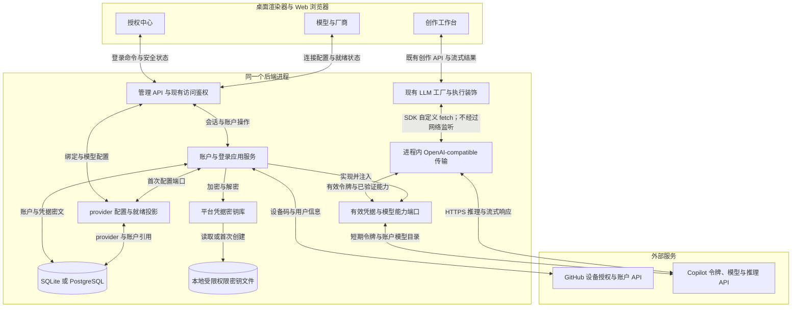
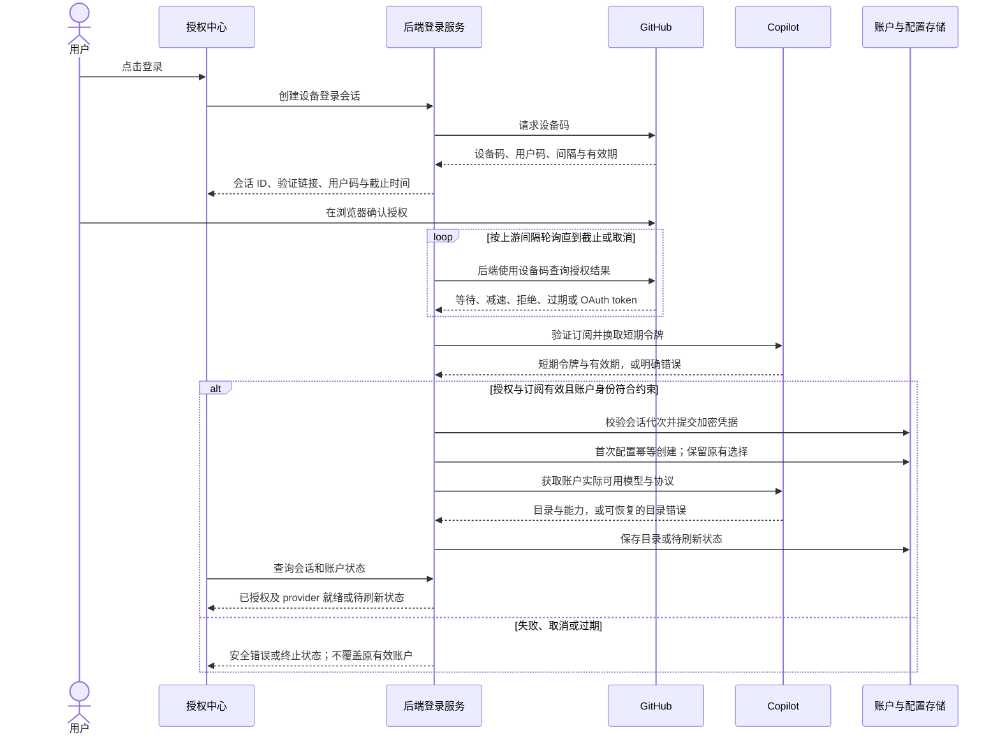
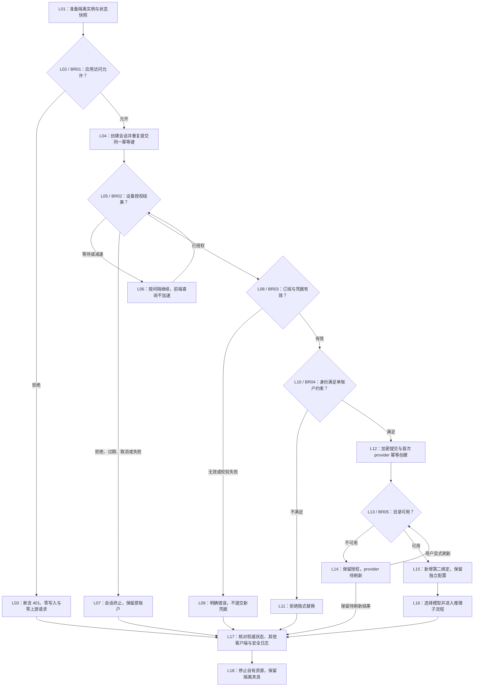
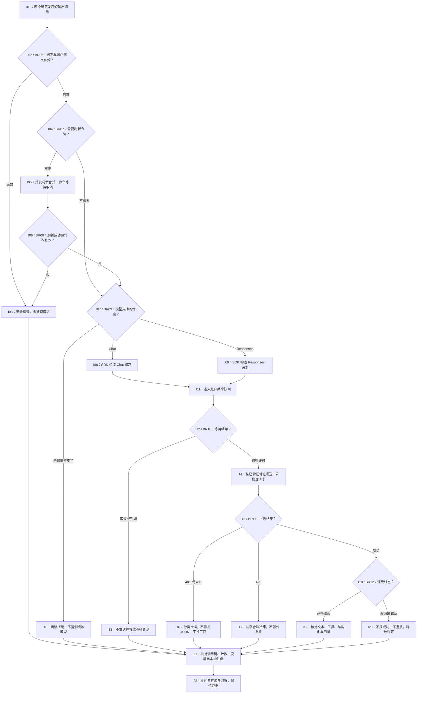
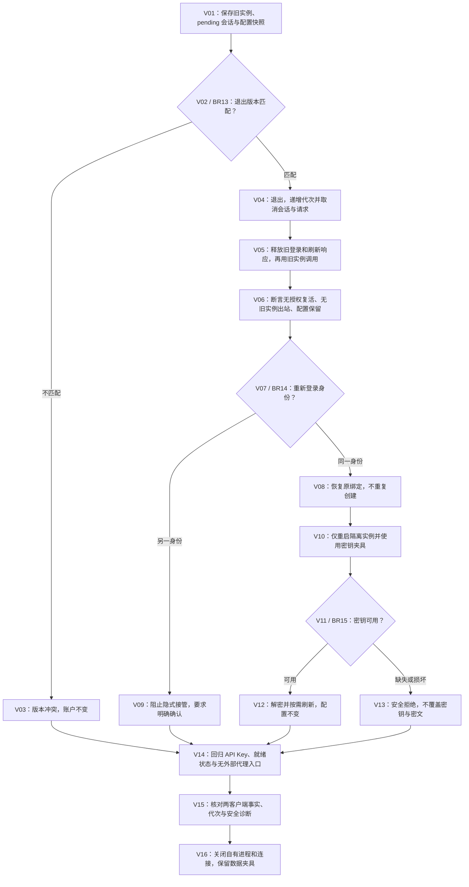

# GitHub Copilot 授权中心与内部代理

## 一、目标和需求描述

### 1.1 目标与适用范围

让已有 GitHub Copilot 订阅的用户，在本项目内完成一次授权后使用账户支持的文本模型，
无需另外安装 cc-switch、启动代理、复制令牌或填写内部 API 地址。

桌面版和 Web 自部署版共用服务端实现；一个部署实例只有一个账户槽位，多个 provider
可绑定同一槽位。不同桌面安装与独立 Web 部署不自动同步账户。首期沿用应用的单服务进程部署，
不引入跨实例令牌锁、分布式队列或多租户账户体系。

主流程：

1. 在“设置 → 授权中心”发起 GitHub 登录，打开 GitHub 验证页面并输入设备用户码。
2. 后端完成授权、验证 Copilot 订阅、保存账户凭据，首次登录创建一个 Copilot provider。
3. 后端拉取可用文本模型，用户可测试连接并在现有模型选择入口选择使用。
4. 在“模型与厂商”创建其他 provider，选择同一 Copilot 账户，分别维护默认模型与请求限制。
5. 聊天、规划、结构化生成、工具调用和流式章节生产通过现有 LLM 入口访问内部代理。

### 1.2 已确认需求

| 编号 | 可观察验收标准 | 负责模块 |
| --- | --- | --- |
| R01 | 桌面与 Web 均能从授权中心发起 GitHub 设备码登录，并看到等待、成功、拒绝及过期结果。 | 授权中心前端、账户应用服务 |
| R02 | 每实例最多一个 Copilot 账户；多个 provider 共享授权，provider 记录不保存 GitHub/Copilot 令牌副本。 | 账户存储、连接绑定 |
| R03 | 首次授权创建一个 Copilot provider 并拉取模型；重复登录不重复创建，不覆盖已有 provider 配置或当前模型选择。 | 首次配置编排 |
| R04 | 新增或编辑 provider 可选择绑定账户，不要求输入 API Key 或内部代理地址。 | 模型与厂商前端、连接配置 |
| R05 | 内部代理覆盖模型列表、连接测试、普通/流式文本生成，以及模型能力允许的结构化输出与工具调用；不支持的能力明确提示。 | LLM 工厂、内部代理、能力兼容层 |
| R06 | 短期令牌按有效期自动刷新；授权失效、订阅不可用、模型不可用和受限结果可辨认，不静默更换账户或模型。 | 凭据服务、上游适配、错误投影 |
| R07 | 退出登录保留 provider 配置与创作数据，关联 provider 标记需授权；重新登录同一账户后恢复绑定。 | 账户服务、就绪状态投影 |
| R08 | 敏感令牌仅由后端持有，不返回前端、不进入日志；无对外代理地址、代理密钥或独立监听端口。 | 密钥库、管理 API、内部传输 |

首期不包含图片生成、向量模型、多账户切换/轮询、GitHub Enterprise、额度看板及外部代理服务。
不改变自动导演的质量门禁、章节保存边界、运行记录的只读职责和业务 Prompt。

### 1.3 需求解释

- “一个账户”指服务端实例共享的账户，不是浏览器本地账户，也不是新增项目用户系统。
- “多个 provider”指多个独立连接配置，共享授权而非共享默认模型、隐藏模型和 provider 请求限制。
- “可用模型”必须同时满足账户可访问和首期传输协议可支持；不承诺订阅目录内每个模型拥有相同能力。
- 新 provider 不主动切换现有当前模型。没有任何可运行 provider 时，沿用项目已有的首次就绪选择规则；
  自动配置过程本身不写入 `llm.currentSelection`。
- 退出指清除本地授权，不承诺代替用户撤销 GitHub 端 OAuth 授权；界面可提供 GitHub 授权管理链接。
- 第三章区分隔离合同测试与真实订阅端到端验收，不能用前者代替后者。

## 二、技术方案

### 2.1 选型与理由

| 决策 | 方案 | 替代方案及取舍 |
| --- | --- | --- |
| D01 内部代理 | 在现有 Node 服务内提供 OpenAI-compatible 请求传输模块，经 SDK 的自定义 `fetch` 注入；不挂载推理 HTTP 路由。 | 另起本地 HTTP 代理也能兼容 SDK，但增加端口、访问令牌、桌面生命周期和 Web 回环配置，首期不需要。 |
| D02 协议支持 | 依据实时目录的 `supported_endpoints` 明确选择 Chat Completions 或 Responses；使用现有 OpenAI SDK/LangChain 实现解析、工具分片和流式消费。 | 只支持 Chat Completions 会漏掉 Responses-only 模型；自己编写跨协议流转换会扩大正确性风险。 |
| D03 凭据持久化 | 数据库只存加密 GitHub OAuth 凭据，后端使用单独的本地密钥文件解密；短期 Copilot token 只存内存。 | 沿用现有 API Key 明文持久化改动少，但数据库备份直接暴露可续期授权；仅用 OS 钥匙串则无法复用 Web/Linux 部署。 |
| D04 provider 合同 | 新增显式连接来源和账户引用，保留原来的 `authMode` 作为 API Key 连接的 HTTP 鉴权方式。 | 把订阅账户塞入 `key` 或特殊 URL 会混淆鉴权和绑定，无法可靠投影登录状态，也容易泄露令牌。 |
| D05 重试与模型身份 | 沿用既有业务重试预算；代理不重放生成、不降级到另一模型，不按模型名称猜协议或推荐替代模型。 | 自动换模型或叠加代理重试会造成费用、重复生成和问题归属不明确。 |

沿用项目现有 React、TanStack Query、Express、Prisma、
SQLite/PostgreSQL、LangChain 和 OpenAI SDK，不新增产品依赖或 Prompt。

SDK 核对依据：当前安装的 `@langchain/openai` 暴露 `useResponsesApi`；
OpenAI SDK 暴露 `configuration.fetch`。这只证明扩展点存在，不证明真实 Copilot 调用已经通过。

### 2.2 模块与依赖边界

| 所有者与建议位置 | 职责与状态所有权 | 对外合同与允许依赖 |
| --- | --- | --- |
| `client/src/pages/settings/authorization/` | 授权中心、设备码会话展示、账户状态和受影响 provider 导航；不持有 token。 | 只调用管理 API，使用项目自有 UI primitives；由设置路由和设置导航接入。 |
| `server/src/modules/authorization/domain/` | 单账户约束、账户状态、会话状态、错误类别与绑定校验规则。 | 纯领域类型/规则，不依赖 Express、Prisma 或 LLM 业务。 |
| `server/src/modules/authorization/application/` | 登录生命周期、退出、单账户替换确认、首次 provider 配置编排。 | 使用端口访问凭据基础设施、数据库、模型目录；由应用组合入口注入 provider 配置端口，避免循环依赖。 |
| `server/src/modules/authorization/infrastructure/` | GitHub 设备码和用户信息、Copilot token/目录请求、账户仓储实现。 | 使用平台密钥库；不调用章节生产或导演服务。 |
| `server/src/modules/authorization/http/` | 状态、登录、取消、退出等管理接口；校验请求并映射安全响应。 | 通过模块 `index.ts` 暴露 router 与应用服务，不对外暴露内部目录实现。 |
| `server/src/platform/security/credentials/` | AES-256-GCM 加解密与本地密钥文件生命周期，不理解 GitHub 业务。 | 只接受密文、明文和密钥标识，不向日志输出材料。 |
| `server/src/platform/llm/subscription-proxy/` | 内部请求校验、按已确认连接转发、流式背压/取消、账户级请求协调、安全错误。 | 通过注入的订阅凭据/模型能力端口使用账户模块；不反向深导入业务模块。 |
| 现有 LLM 工厂/目录/连接测试 | 统一解析连接来源，创建 SDK 客户端，保留执行预算、日志、用量和兼容性装饰。 | 仅通过代理与授权模块 facade 组装；普通 API Key 路径保持原行为。 |
| 现有设置服务与路由 | 存储 provider 自身模型和连接绑定，投影 `ready`、`needs_authorization` 等状态。 | 不复制账户 token；就绪度通过同一连接解析入口获取。 |

LLM 工厂拥有“怎样构造模型客户端”，授权模块拥有“账户与有效凭据”，代理拥有“怎样安全发送物理请求”。
组合入口连接这些端口；底层平台模块不得 import 上层业务模块内部实现。

新增代码使用职责目录，不向已有高密度目录继续堆积同名前缀文件。
现有 `settings.ts` 若超过 1,300 行，接入相关设置前先按 HTTP 映射、配置编排和状态投影职责拆分，
通过 facade 保持既有导出；不进行与本功能无关的全目录重构。

### 2.3 架构与数据流

[审阅架构设计](./copilot-authorization-dev-design.html)

架构总览源码与 `copilot-authorization-dev-design.mmd` 一致：



登录与重连时序源码与 `copilot-authorization-login-sequence.mmd` 一致：



图中所有前端管理通信复用应用 API 的 Bearer/HttpOnly 会话保护；
桌面仍由现有 runtime 注入应用访问令牌。前端只直接访问 GitHub 的浏览器验证页面，
不直接调用 token 或推理端点。创作 API 与工作台沿用原有返回方式。

### 2.4 数据合同与生命周期

**账户与绑定**

- 新增 `AuthorizationAccount`：稳定槽位 ID、唯一 `service=github_copilot`、GitHub 用户 ID/显示名、
  账户状态、加密凭据封装、凭据代次 `credentialRevision`、首次配置完成标记及时间戳。
- `APIKey` 增加 `connectionType`，默认 `api_key`，以及可空的 `authorizationAccountId`。
  `copilot_subscription` 连接必须引用该槽位，API Key 连接不得携带账户引用。
- 采用新表与可空/默认列的增量迁移，同时维护 PostgreSQL 和 SQLite；不重置数据库、不搬移原密钥。
- token 不进入 `APIKey.key`、`availableModels`、前端表单、查询缓存或 LLM 客户端元数据。
- 首次创建 provider 的唯一标识和完成标记在事务中幂等保存。目录获取不放在数据库长事务内；
  拉取失败时仍保留已授权账户和待刷新 provider，不能误显示为可运行。
- 人工删除过的自动 provider 不因每次重新登录而复活；用户可手动新增绑定。
- 退出后账户槽位和绑定保留，凭据被置空并增加代次；未完成登录会话、排队调用和旧 token 缓存全部失效。
  已经到达上游的请求不承诺撤回计费；终止本地流且不得保存为成功完成。
- 有在用账户时，不允许后台登录静默改成另一个 GitHub 用户。需要先退出并明确确认将已有绑定接到新身份；
  首期不提供保留两个账户并切换的能力。

**密钥与备份**

- 使用 Node `crypto` 的 AES-256-GCM，每次加密生成独立随机 nonce；封装携带算法版本、
  key ID、nonce、密文和 tag，以槽位/service 作为附加认证数据。
- 本地主密钥首次需要保存授权时安全创建；POSIX 目录/文件权限为 `0700`/`0600`，
  Windows 依赖应用私有目录 ACL。对已有密钥绝不自动覆盖或重新生成。
- 桌面放在应用 userData 的私有 credentials 目录；Web 放在可配置的持久化凭据目录。
  部署必须持久化该目录，不把密钥写入镜像、源码、日志、数据库或渲染器。
- 有密文但密钥丢失/损坏时安全拒绝解密，提示恢复原密钥或重新授权，不静默生成新密钥覆盖数据。
- 普通数据库备份不包含可解密授权的全部材料；恢复既有授权需要数据库和对应密钥。
  首期不扩展桌面日志包或数据库导入为凭据导出功能，不把主密钥混入诊断包。
- 本设计不授权对当前开发数据库执行迁移或清理；后续验证使用隔离数据库。

**账户、会话与模型状态分离**

| 状态对象 | 状态与规则 |
| --- | --- |
| 账户 | `signed_out`、`authorized`、`reauthorization_required`、`subscription_unavailable`、`credential_unavailable`；网络短暂失败不等于退出。 |
| 登录会话 | `pending`、`succeeded`、`denied`、`expired`、`cancelled`、`failed`；设备码仅后端内存保存，进程重启后需重新发起。 |
| 模型目录 | `ready`、`refresh_required`、`unavailable`；与账户授权分开，目录故障不清除有效凭据。 |
| provider | 综合启用状态、绑定、账户、模型目录与已保存模型得到 `ready`、`needs_authorization`、`needs_model` 或明确错误。 |

读取状态接口不刷新 token、不做远程探测、不发起新登录。页面仅在登录会话 pending 时按服务端建议间隔查询，
失焦后恢复查询即可；另一浏览器通过相同服务端事实收敛，不新增 WebSocket。

### 2.5 管理 API 与内部合同

建议管理路由挂载在 `/api/authorization`，全部经过既有 `/api` 访问鉴权，不增加 OAuth callback 豁免。

| 操作 | 输入与输出 | 一致性和失败语义 |
| --- | --- | --- |
| `GET /accounts/github-copilot` | 返回账户安全摘要、绑定 provider、目录状态、可执行下一步。 | 无 token、无设备码、无远程副作用；`Cache-Control: no-store`。 |
| `POST /accounts/github-copilot/login-sessions` | 接收登录幂等键；返回 session ID、验证链接、用户码、截止时间与建议查询间隔。 | 同一请求重试不重复启动；已有 pending 会话返回同一会话或明确冲突；不返回 `device_code`。 |
| `GET /login-sessions/:id` | 查询安全状态与归一错误类别。 | 无副作用；不存在/重启后丢失返回明确结果，不假装成功。 |
| `POST /login-sessions/:id/cancel` | 取消该会话。 | 可重复调用；终止轮询，代次阻止晚到成功写回。 |
| `POST /accounts/github-copilot/logout` | 接收当前账户版本；响应已退出及受影响 provider。 | 同时取消登录、撤销本地可用凭据；旧版本返回冲突；不删除 provider 或小说。 |
| 现有 provider 保存/测试/刷新接口 | 增加连接来源和账户引用；订阅连接不能同时提供 API Key 或任意上游 URL。 | 模型目录、测试、正式生成使用同一连接解析器；服务端不信任前端的 ready。 |

设备登录轮询由后端负责，遵守上游 `interval`、`slow_down` 与 `expires_in`，
不随前端查询次数加速；取消、到期、进程关闭时清理定时器。
用户码属于临时敏感信息，允许当前登录页面展示，不写入 URL、日志或遥测。

内部代理合同是标准 `Request -> Response`/`fetch`，不是产品 HTTP 路由：

- 仅工厂对已验证的订阅绑定注入专用 fetch。可用固定逻辑 origin 标记 SDK 请求，
  该 origin 不是 DNS 地址或对外 baseURL；不注入时不能退回真实网络 fetch。
- 仅允许明确的方法和协议路径，例如 `POST /chat/completions`、`POST /responses`；
  模型目录通过同一模块 facade 使用账户级目录服务，不另走普通 `/models` 拼接。
- 每次物理请求重新检查账户代次和有效性，不能只在 LLM 实例创建时检查；
  旧实例在退出/替换后也必须失败。
- 上游 origin 仅来自受校验的 GitHub/Copilot 元数据和允许的 HTTPS 主机集合；
  禁止任意用户 URL、userinfo、私网目标和带鉴权跨域重定向，防止令牌外送。
- 不转发应用访问令牌、浏览器 Cookie 或 SDK 的占位 API Key。仅凭据端口在发送前注入真实上游认证头。
- 参考实现中的兼容性请求头需逐项核对，仅发送实际协议必需字段，不伪造用户互动、
  修改计费语义或规避 GitHub 的限制；不能直接复制整组第三方头。
- SDK 保持 `maxRetries: 0`。代理不对生成错误自行循环重试，不在流已输出后重放请求。

### 2.6 模型目录、协议与业务兼容

- 保留 Copilot 返回的模型 ID、支持端点、上下文与输出上限、工具/结构化/推理能力；
  使用 Zod 校验，未知字段可保留必要扩展，缺失关键字段不当作支持。
- 同时支持 Chat 与 Responses 时优先 Chat，减少与现有项目路径的差异；
  仅支持 Responses 时使用 SDK 原生 Responses 实现。仅支持其他协议的模型标记不可用，
  不按 GPT/Claude 名称猜测、不自动改名或切换到另一个模型。
- 更新模型目录时同时更新受影响绑定的候选模型投影，不覆盖各 provider 的默认模型和隐藏项。
  已选模型从上游消失时显式提示重新选择，不凭目录首项偷偷替换。
- 结构化能力由上游明确字段和既有兼容性探测/用户覆盖共同构成；
  不宣称模型支持未报告的 JSON Schema 或工具调用。缺少原生结构化能力时，
  仍可按既有 Prompt Registry 的结构化调用合同使用 prompt JSON 路径，不新增内联业务 Prompt。
- 思考、temperature、输出 token 上限及工具模式根据所选传输和能力档案适配；
  不把某厂商直连专用参数根据模型名注入 Copilot 请求。
- 现有路由选择、执行预算、用量归属、取消和日志装饰继续包裹 SDK，不在代理再记一条重复逻辑调用。
  不支持显式缓存参数的 Copilot 路径不增加直连厂商专用 cache 标记。
- 订阅 provider 不用于图片生成和 embedding，不对这些入口投影为可选连接。
- 需要强制 Anthropic 原生协议的路由若选择订阅连接，保存时说明不兼容并拒绝，
  不在运行时偷偷忽略协议配置。

### 2.7 刷新、限流、取消与错误

- 短期 token 在到期前预留 60 秒刷新；同一账户使用 single-flight 合并并发刷新，
  等待者取消不能误取消其他正常请求共享的刷新。刷新成功前再次校验凭据代次。
- 仅保留进程内 token 与能力缓存；退出/重新授权使其失效。服务重启后用加密 OAuth 凭据按需换取新 token。
- 沿用 provider 自身的模型级限制；所有绑定额外共享账户级发送协调器，
  建议首期账户并发上限为 1，避免多个 provider 绕过同一订阅的请求约束。
  这是本地保护默认值，不代表 GitHub 允许的固定额度或安全使用频率。
- 账户队列等待必须计入调用截止时间，支持 AbortSignal，流结束/异常/取消时只释放一次许可。
  `429` 按有效 `Retry-After` 建立账户共享冷却；没有该头时直接返回受限，不编造解除时间。
- 上游 `401` 使当前短期 token 失效，本次生成返回安全错误，不内部重放；
  下次调用按正常凭据合同刷新。只有 OAuth 校验/换取明确失败才标为需重新授权。
- `403` 区分订阅/组织策略/模型权限，仅在明确结构化错误支持时分类；
  无法辨认则保留“访问被拒绝”，不能全部解释成“请重新登录”。
- 账户级错误携带稳定类别，例如 `COPILOT_AUTH_REQUIRED`、`COPILOT_SUBSCRIPTION_UNAVAILABLE`、
  `COPILOT_RATE_LIMITED`、`COPILOT_MODEL_UNSUPPORTED`、`COPILOT_CREDENTIAL_UNAVAILABLE`。
  应传到既有执行层，认证/订阅错误不得当成模型输出格式错误启动 JSON 修复或偷偷切换厂商。
- 保持业务已有保存边界；流中断不能被投影为完整成功。已有章节质量债务规则不受本功能改变。

### 2.8 前端与访问保护

- 设置侧导航新增“授权中心”；页内只显示 GitHub Copilot 一组，不制作不可用服务的占位入口。
- 展示账户名、授权状态、关联 provider 数量和具体错误；登录中展示用户码、有效期、
  打开 GitHub/复制用户码/取消，已授权提供重新授权和退出。
- provider 表单用连接来源选项区分 API Key 与 GitHub Copilot；选择订阅时隐藏 Key、baseURL、
  图片模型等不适用字段，显示绑定账户和“管理授权”入口。
- provider 卡片、顶部模型选择、快速配置与首次小说就绪度必须读取同一 `ready` 投影。
  账户失效时保留配置入口和警告，不把保留的模型目录当成可运行依据。
- Web 自部署沿用部署者现有应用访问保护。未设置应用访问令牌时，
  授权中心不是独立多用户隔离边界；所有能访问该部署的人共享同一授权和权限。
  对外部署应开启现有应用访问保护并使用 HTTPS，界面不得暗示登录 GitHub 会保护整个应用。
- 验证链接使用受校验的 GitHub HTTPS 地址，桌面浏览器打开和 Web 新窗口均遵守既有宿主安全机制。
- 采用项目语义色、低边框布局和现有组件，不引入 UI 库；UI 验收由用户执行，不默认启动浏览器测试。

### 2.9 可观测性与性能

复用现有调用记录与结构化服务日志，不为首期引入 Prometheus 或新仪表盘。
日志事件允许按固定低基数操作/结果聚合；account/provider ID 仅用作日志关联，不作指标标签。

| 旅程 | 安全信号与统计方式 | 诊断动作 |
| --- | --- | --- |
| 设备登录 | `authorization.session`：request/session ID、操作、结果类别、耗时、上游状态；按结果计数与持续时间统计。 | 授权中心显示拒绝/过期/网络结果；日志不含设备码、用户码、token 或原始授权响应。 |
| token 刷新 | `subscription.token_refresh`：凭据代次、成功/失败类别、耗时；刷新次数及合并等待次数。 | 重复换取失败时引导重新授权；检查并发刷新是否合并，而不是重复登录。 |
| 模型刷新 | `subscription.catalog`：结果、模型数、目录版本、耗时。 | 区分授权有效但目录失败，允许从模型与厂商重试刷新。 |
| 正式调用 | 现有 usage/invocation 记录加连接来源与实际传输类型；代理诊断记录 queue wait、上游状态和错误类别。 | 保留既有 request/call chain 关联；不记录上游认证头、凭据、原始敏感错误或完整请求配置。 |
| 限流与取消 | 按结果统计限流次数、排队耗时、取消次数和许可释放；用既有诊断日志聚合。 | 区分排队慢与上游慢，确认没有持有已结束流的许可。 |

上游耗时、队列等待和 SDK 完整调用耗时分开统计；TTFT 及 Tokens 沿用既有 usage 合同，
上游不返回用量时记录未知，不用订阅状态推算费用或虚构缓存命中。

性能先采集基线：同机单服务进程、20 个绑定、100 个模型、有效缓存状态下，
比较 API Key 与订阅连接的本地解析开销；另测两个绑定同时发请求的队列/取消行为。
建议预算是排除数据库冷启动和外网耗时后，本地代理处理新增 p95 小于 20ms；
未经实测不得宣称达标。外网授权与模型生成耗时不纳入此本地预算。
状态查询不依赖外网，模型与 token 缓存命中不能为每次调用重复访问目录/换取端点。

### 2.10 交付切片与风险

在当前 checkout 的独立 `codex/` 功能分支实现，不另建 worktree。
本方案提出的交付范围为本地分阶段实现、代码检查、文档维护与阶段提交；
推送、PR、合并、发布及操作现有数据库不在该执行范围内。
产品改动后续集成走功能分支 → `beta` → `main`，阶段提交遵循仓库要求。
真实账户授权及 UI 验收由用户配合完成；未取得结果时，必须保留对应验收缺口，
可以交付本地代码供验收，但不能报告完整功能已经端到端验证。

| 切片 | 包含边界 | 阶段验收条件 |
| --- | --- | --- |
| P1 授权与凭据基础 | 双数据库增量合同、平台密钥库、设备登录、会话取消、账户与订阅状态。 | 隔离存储测试通过；凭据不外泄；真实设备登录/token 交换作为后续人工授权验收，不将 mock 视为已证实。 |
| P2 代理与 provider 绑定 | 单账户多绑定、首次配置、模型能力目录、Chat/Responses SDK 接入、错误与执行边界。 | 正常、流式、工具分片、结构化、取消、刷新合并和多绑定限流的针对性测试通过；旧 API Key 路径回归通过。 |
| P3 前端与集成 | 授权中心、provider 表单/卡片、全局就绪投影、Wiki 与用户说明。 | 类型和导航/状态合同检查通过；UI 与真实订阅端到端验收由用户完成并保留待验收项。 |

主要风险：

1. Copilot 订阅推理与 token 交换并非本项目获得保证的公开 API 合同；参考实现使用既有 OAuth 客户端标识，
   不能假定任意新建 OAuth App 都有相同权限。实施首先核验所用客户端、必要协议头、订阅/组织策略，
   不承诺永远可用，也不绕过上游授权、额度或风控。真实可用性需要用户授权下验证。
2. 模型目录与端点可能变化；按结构化元数据适配，不照搬 cc-switch 的模型名家族降级。
   新增未支持协议必须作为单独能力扩展评审。
3. 加密数据依赖对应主密钥；部署/恢复说明必须明确持久化目录和密钥丢失后的重新授权路径。
4. 原有 LLM 工厂存在缓存，旧实例不能携带长期可用的旧授权；每次发送校验代次是安全约束，不可省略。
5. 阶段验收中真实 GitHub 登录、真实 Copilot 推理和桌面/Web UI 与隔离 mock 测试分开记录，
   没有用户验收结果不能报告端到端全部完成。

实施时补充 `docs/wiki/architecture/` 的授权/代理边界与 `docs/wiki/workflows/` 的登录恢复合同，
并更新模型选择边界。它们应解释状态事实源、凭据安全和恢复原因，不写成文件修改清单。
用户可见功能完成后，再按仓库规则更新发布说明与 README 最新更新；设计草稿不声称功能已提供。

### 2.11 核对来源

- 本项目：`server/src/llm/factory.ts`、`modelCatalog.ts`、`requestLimiter.ts`、
  `compatibility/README.md`、`services/settings/secretStore/`、`runtime/appPaths.ts`、
  `middleware/auth.ts`、双 Prisma schema、设置页及模型选择 Wiki。
- [cc-switch 固定参考提交](https://github.com/farion1231/cc-switch/tree/176bb05ee2d90c877cbd877ba10a55e953869cec)：
  `src-tauri/src/proxy/providers/copilot_auth.rs` 的设备登录、有效期、账户刷新锁与目录能力，
  `copilot_model_map.rs` 的端点元数据，以及 `src/components/settings/AuthCenterPanel.tsx` 的入口职责。
- 只参考职责和协议事实，不照搬多账户、模型家族静默替换、外部代理服务或第三方 UI 样式。

## 三、E2E 测试方案

### 3.1 范围、分工与进入/退出条件

本章对应本文 R01–R08 与 D01–D05，测试同一个部署实例从未授权到完成生成、退出和重新授权的旅程。
用三张子图覆盖登录配置、正式推理和凭据生命周期，全部放入一个评审页面：

[审阅测试流程](./copilot-authorization-test-workflow.html)

严格区分以下证据层级：

| 层级 | 依赖真实性 | 执行责任与能证明的内容 |
| --- | --- | --- |
| C：自动化合同/集成检查 | 真实 Express 路由、SDK、工厂、加密、迁移与隔离数据库；GitHub/Copilot 使用注入的可控 fetch/上游夹具。 | 代理实施后执行，证明协议、分支、状态、竞态和安全边界；不称为真实 Copilot E2E。 |
| E：真实订阅端到端验收 | 用户真实 GitHub 登录、真实 Copilot token、真实模型目录和生成响应，经过应用 UI、后端和持久化。 | 用户执行浏览器/桌面 UI 操作；代理根据提供的结果协助诊断。证明当前环境的真实可用性，不能从 C 推导。 |
| UI：展示与交互验收 | 实际桌面和 Web 页面、剪贴板、外部浏览器打开及响应式布局。 | 默认由用户验收；不自动运行 Playwright、截图或手动浏览器检查。 |

进入条件：完整 spec 和本地实施范围获明确批准；实施代码、隔离测试夹具和对应目标构建就绪。
真实 E 场景还要求用户主动授权、有效 Copilot 订阅及受允许的模型；账号、组织或网络不满足时，
记录具体外部限制，不能通过关闭访问校验或放宽模型判断来让用例通过。

退出条件：

- P1–P3 对应 C 场景、受影响旧路径回归和相关类型检查通过，失败场景没有悬挂流、会话或许可。
- 桌面与 Web 的 E01/E02、同实例重连 E03 与 UI 清单取得用户验收结果。
- 全部关键分支有对应断言，敏感信息扫描、日志关联和性能基线有证据。
- 没有结果的真实 E、UI、PostgreSQL 或平台专属权限检查保持“待验证”，不能报成通过或悄悄移除。

测试计划本身不触发网络探测、账号登录、产品测试或数据库迁移。

### 3.2 环境、夹具与安全边界

**自动化环境**

- 使用现有 Node `node:test` / `node:assert` 和编译后服务模块。测试目录按所有者放入
  `server/tests/authorization/`、`server/tests/subscriptionProxy/`；前端状态/导航合同使用既有 client 测试模式。
- 测试进程启动前设置 `NODE_ENV=test`、独立临时 app data/凭据目录和隔离数据库地址，
  不继承真实 API Key、OAuth token 或开发数据库 URL。未拦截的外部 fetch 默认抛错，
  不允许某个 mock 漏配后落到真实 Copilot。
- 管理 API 在随机 loopback 端口启动最小路由组合及真实访问鉴权，不启动生产后台 worker。
  上游夹具经测试进程内依赖注入，不增加“允许任意上游主机”的生产配置开关。
- 使用真实 SDK 生成/消费请求，模拟 Chat 与 Responses 的合法返回、分片工具参数、usage 和错误，
  不用自写假的 `getLLM` 替代本功能的核心工厂/代理验证。
- SQLite 使用当前测试模式的私有临时目录；构造旧 schema 的虚拟 provider/小说数据，
  应用增量迁移后比较数量、原字段和默认值。PostgreSQL 在用户提供的专用空测试库执行同一关键存储合同。
  不对已有开发/生产库执行 reset、drop、truncate 或清理。
- 故障时间通过可控时钟/调度器推进：授权等待和 slow_down、临近到期、队列截止时间、
  Retry-After 冷却均不靠长时间 sleep。并发竞态使用可控屏障释放上游响应。
- 假令牌、设备码和用户码用专用哨兵值，断言这些值没有进入管理响应、日志、调用载荷、URL、
  provider 数据和错误详情；只允许当前登录响应中展示用户码。
- 测试结束关闭自有 HTTP listener、stream、定时器及 Prisma 连接，恢复注入依赖。
  数据库和密钥夹具保留于标识明确的临时目录，不自动删除文件，不导出真实凭据。

**真实验收环境**

- Web：同站点前后端，启用既有应用访问令牌保护；本地可用 HTTP，远程部署使用 HTTPS，
  记录持久化凭据目录已配置。桌面：使用真实 Electron 托管后端与 userData 目录。
- 使用专门的验收小说/空白创作结果，不修改已有长篇正文；测试模型调用采用短输入和小输出预算。
  发起真实推理前由用户确认模型及订阅消耗，不遍历全部模型自动探测。
- 至少验证账户可访问的一条真实传输。若目录没有 Responses-only 或支持工具/结构化的模型，
  说明该真实能力暂不可验证；对应 SDK 合同仍必须在 C06/C09 中覆盖。
- 同实例跨客户端使用两个浏览器会话验证状态收敛；桌面与独立 Web 部署不共用凭据的事实不能误判为同步故障。
- 进程重启仅针对验收实例。验证缺失/损坏密钥只能在 C11 的自有副本进行，不改真实主密钥。
- 不在 spec 内写执行结果、账号信息、日志路径或截图流水；结果保留在任务汇报/后续已授权 PR 简介中。

### 3.3 场景、断言与证据

所有 C 场景均为本地自动化验收必需；E 场景是完整端到端交付的必需条件。
非关键页面外观细节由 UI 清单覆盖，不增加穷举式单元测试矩阵。

| 场景 | REQ / BR | 准备与操作 | 可观察通过标准 | 边界与证据 |
| --- | --- | --- | --- | --- |
| C01 访问保护 | R01/R08；BR01 | 启用应用令牌，分别发送有效、缺失和错误认证的状态/登录请求。 | 允许路径工作；拒绝返回 401，账户/会话不改变，上游调用数为零；状态 GET 无远程副作用。 | 真实 HTTP/鉴权；响应、仓储快照、fetch 调用记录。 |
| C02 设备登录生命周期 | R01/R06；BR02 | 夹具依次给出 pending、slow_down、授权、拒绝、过期、取消、网络失败；对同一幂等键重复启动。 | 后端不加速轮询，终态停轮询；失败不覆盖原有效账户，重复请求不创建第二个活跃会话，设备码不返回前端。 | 路由→会话→上游；可控时钟、请求计数、终态与安全日志。 |
| C03 订阅校验 | R01/R06；BR03 | OAuth 成功，token 交换分别成功、明确无订阅、401、网络失败或未知 403。 | 只在校验成功时提交新授权；无订阅与需授权/网络错误可辨认，未知拒绝不误称无订阅，已有账户不被失败尝试覆盖。 | 登录→token→账户仓储；错误类别和写入次数。 |
| C04 单账户与幂等配置 | R02/R03/R07；BR04/BR14 | 同一身份重复授权、另一个身份尝试替换、已手动配置/删除自动 provider；两请求并发提交。 | 只有一个槽位，首次 provider 最多一个；保留默认模型/隐藏项/当前选择；另一身份不静默替换，需退出并显式确认；已删除的自动 provider 不复活。 | 事务与首次配置端口；数据库约束、完整配置前后对比。 |
| C05 目录与就绪投影 | R03/R04/R05/R06；BR05 | 目录成功、失败后显式刷新、模型消失；添加第二绑定，分别设置模型和隐藏项。 | 目录失败保留授权但不伪造 ready；刷新成功恢复候选，默认模型不被覆盖；失效模型需重选；所有就绪入口与服务端事实一致。 | 目录→provider→选择/引导投影；响应、持久化目录和前端状态合同。 |
| C06 传输与能力 | R05/R08；BR06/BR09 | Chat-only、Responses-only、同时支持、未知/缺失端点；连接测试与正式工厂调用相同连接。 | 精确选定路径；双支持优先 Chat；未知协议、强制 Anthropic、图片/embedding 入口明确拒绝；不发往虚拟 origin，不走 Anthropic 探测、不改模型 ID。 | 真实 SDK/自定义 fetch→受控上游；方法、路径、模型与参数断言。 |
| C07 刷新与并发 | R02/R06；BR06/BR07/BR08 | 有效/临期 token，两个绑定同时需要刷新，一个等待者取消，刷新成功/失败与退出交错。 | 缓存有效不重复换取；并发刷新合并为一次；单个取消不影响其他等待者；失败无推理发送，旧代次结果不能写回。 | 凭据端口→token 请求；计数、代次、上游屏障和取消结果。 |
| C08 队列与受限 | R02/R05/R06；BR10/BR11 | 两个 provider、不同模型并发；排队取消/到期；429 带合法或缺失 Retry-After。 | 账户最大活跃推理为 1，provider 限制仍有效；未获许可不发送；流结束只释放一次；合法冷却影响所有绑定，缺头不编造时间，无代理额外重放。 | provider 限制→账户协调器→上游；活跃数、发送时间与许可收支。 |
| C09 生成语义与故障 | R05/R06；BR11/BR12 | 两协议的普通、流式、工具分片和结构化结果；流取消/截断；401/403；配置备用模型后触发授权错误。 | 文本/工具参数/结构化结果与 usage 正确；中断不报成功、不重放；授权错误不触发 JSON 修复/跨厂商兜底，其他错误遵守已有请求预算。 | 工厂→SDK→代理→执行层/用量；结果、调用链、物理请求与备用厂商计数。 |
| C10 退出与旧实例 | R02/R07/R08；BR13/BR14 | 持有旧 SDK 实例、pending 登录、刷新和排队请求；分别使用当前/过期版本退出，再放行晚到响应。 | 过期版本冲突且状态不变；成功退出清空本地凭据并递增代次，旧实例/回调不恢复授权；小说和 provider 配置不删除；同身份重新授权恢复绑定。 | 账户命令→缓存/流/队列→状态投影；写入、出站请求和配置对比。 |
| C11 持久化与增量迁移 | R02/R07/R08；BR15 | 旧 schema 虚拟数据迁移；保存授权后重启子进程；用自有密钥副本构造丢失/损坏。 | SQLite/专用 PostgreSQL 保留旧数据；仅正确密钥可解密；重启按需刷新；损坏时安全拒绝且不覆盖密钥/密文；文件权限符合目标平台。 | Prisma、真实文件加密、跨进程；迁移前后字段、文件权限和解密结果。 |
| C12 传输与泄露防护 | R08；BR01/BR09/BR11 | 恶意上游 origin、私网目标、userinfo、重定向；错误体嵌入哨兵；尝试外部访问推理路由。 | 不向被拒目标发送 token；不转发应用 token/Cookie；HTTP 无本功能推理路由/额外 listener；管理响应/日志/记录无令牌或设备码。 | URL 校验→fetch→错误投影；零请求断言、哨兵扫描与路由结果。 |
| C13 观测与性能 | R05/R06/R08；BR07/BR10/BR11/BR12 | 汇总成功、失败、取消；20 绑定/100 模型的暖缓存基线，预热后各采样至少 100 次。 | 计数与真实请求匹配，耗时边界可区分，无重复 invocation；缓存不重复访问上游；报告本地 p95 与基线差，未达目标不宣称通过。 | 既有 usage/诊断→统计；安全日志、关联 ID、采样分布和测试机信息。 |
| C14 客户端合同回归 | R01/R03/R04/R07 | 检查设置路由、表单连接来源、授权/目录状态转换与查询失效；回归旧 API Key 模式。 | 授权状态变化刷新所有就绪入口；订阅不显示 Key/baseURL/图片字段；API Key 的 bearer/x-api-key/none 与既有选择行为不变。 | 代码级导航/状态检查，不冒充 UI 验收；client 测试与相关类型检查。 |
| E01 Web 真实闭环 | R01–R06/R08；主流程 | 用户在验收 Web 实例登录、查看自动 provider、添加第二绑定、测试连接、选择模型并生成短文本/结构化结果；按模型能力验证一次只读工具调用。 | 真实授权与目录可见，两个绑定可分别调用；工具参数与只读结果正确；模型选择只随用户操作改变；成功结果经过既有保存边界；真实日志可关联且无敏感值。 | UI→真实后端/DB→GitHub/Copilot；用户反馈与脱敏请求/调用记录。 |
| E02 桌面真实闭环 | R01–R06/R08；主流程 | 使用 Electron 托管后端重复核心登录/生成，并重启验收实例。 | 外部浏览器能完成授权；renderer 无 token；重启后绑定和授权仍可用，且不要求另外启动代理。 | 桌面 runtime/权限→真实上游；用户反馈、脱敏调用记录。 |
| E03 真实退出与恢复 | R02/R03/R07/R08；BR13/BR14/BR15 | 同一 Web 实例两个会话，退出后从另一会话尝试新调用，再登录同一 GitHub 身份；桌面验证同身份重连。 | 新调用因需授权而失败；下一次查询/页面激活时状态收敛；重新授权不重复创建，不覆盖配置；原小说与保存结果仍存在。 | 多客户端→同一账户事实→持久化；前后安全状态、用户反馈。 |

### 3.4 关键分支与必需结果

| 分支 | 条件与全部必需结果 | 图节点 / 场景 | 风险理由 |
| --- | --- | --- | --- |
| BR01 应用访问允许 | 有效身份允许；缺失/错误身份拒绝且零副作用。 | L02；C01/C12 | GitHub 登录不能成为应用访问校验的绕过入口。 |
| BR02 设备授权结果 | pending/slow_down 继续但不加速；授权进入校验；拒绝/过期/取消/网络终止保持失败可辨认。 | L05；C02、E01/E02 | 避免无限轮询、误报成功和覆盖有效授权。 |
| BR03 订阅与凭据校验 | 有效进入提交；无订阅/无效 OAuth/未知拒绝或网络失败不提交新凭据。 | L08；C03 | 获得 GitHub token 不代表可用 Copilot。 |
| BR04 单账户身份 | 同身份/空槽位可幂等提交；另一身份不静默替换。 | L10；C04 | 保护所有已绑定 provider 的账户归属。 |
| BR05 模型目录 | 可用形成 ready；失败/空有效目录保持授权但需刷新或选模型。 | L13；C05、E01/E02 | 防止目录或静态模型掩盖不可运行连接。 |
| BR06 发送前绑定 | 有效且代次一致才继续；失效/未授权/禁用拒绝且不发送。 | I02；C06/C07/C10 | 旧 SDK 实例不能绕过退出。 |
| BR07 刷新必要性 | 有效缓存直接使用；临期/缺失合并刷新。 | I04；C07/C13 | 避免每次生成重复换 token 或使用过期值。 |
| BR08 刷新结果 | 成功使用新 token；失败/代次失效安全返回，不发推理。 | I06；C07 | 覆盖退出、取消和刷新竞态。 |
| BR09 模型传输 | Chat、Responses 明确分流；未知/不支持拒绝。 | I07；C06/C12 | 不允许按模型名猜协议或泄露到任意地址。 |
| BR10 队列结果 | 获许可继续；等待取消或到期终止且零发送。 | I12；C08/C13 | 多绑定必须共用限制，排队不得泄漏许可。 |
| BR11 上游结果 | 成功进入消费；401/403 安全分类；429 共享冷却并报错。 | I15；C08/C09/C12/C13 | 错误不得重放或误路由到其他付费模型。 |
| BR12 消费终态 | 正常结束汇总；主动取消或截断不成功、不重放且释放资源。 | I18；C09/C13、E01/E02 | 流式生成和工具调用不能只验证 HTTP 200。 |
| BR13 退出版本 | 当前版本原子退出；旧版本返回冲突且不改变有效账户。 | V02；C10、E03 | 防止另一客户端过期操作清掉新授权。 |
| BR14 重新登录身份 | 同身份恢复绑定；不同身份阻止隐式替换并要求明确确认。 | V07；C04/C10、E03 | 单账户不等于任意身份可自动接管绑定。 |
| BR15 持久化密钥 | 原密钥可恢复；丢失/损坏则拒绝解密、不重建覆盖。 | V11；C11、E02/E03 | 数据库存在不代表授权可安全解密。 |

BR11 的一般网络失败、模型消失和未知字段变体合并到 C05/C06/C09 的合同断言，
不在图中展开每一种状态码组合；不能因此省略错误分类、无重放和资源释放断言。

### 3.5 登录与配置测试流程

下图源码与 `copilot-authorization-test-workflow.mmd` 一致。
真实 E 场景走允许/授权/订阅有效/同身份/目录可用主路径；
拒绝与竞态由 C 场景确定性验证，不要求用户撤销真实订阅来造故障。



### 3.6 推理、刷新与流式测试流程

下图源码与 `copilot-authorization-inference-tests.mmd` 一致。
普通、流式、工具与结构化是同一发送/消费合同的不同输入，不意味着每次真实验收都重复收费。



### 3.7 退出、重连与重启测试流程

下图源码与 `copilot-authorization-lifecycle-tests.mmd` 一致。



### 3.8 逐节点通过标准

证据缩写：H=HTTP 安全响应，D=隔离数据库/配置快照，F=受控上游请求计数与内容，
K=自有文件/密钥权限，S=调度器/队列/流状态，O=安全日志与用量，U=用户真实 UI 验收。
表中的计数和内容断言仅使用假凭据或经过脱敏的真实记录。

| 节点 | 可观察通过标准 | 场景 / REQ / BR | 证据 |
| --- | --- | --- | --- |
| L01 | 独立数据/密钥目录和初始快照存在，无真实凭据继承，外部未拦截请求会失败。 | C01–C05；R01/R08 | D/K/F |
| L02 | 有效认证进入 L04，缺失/错误认证只进入 L03。 | C01；R08；BR01 | H/F |
| L03 | 401 可辨认，账户/会话写入和上游请求均为零。 | C01/C12；R08 | H/D/F |
| L04 | 同幂等键只拥有同一个有效会话/设备请求，前端无 device_code。 | C02；R01/R03 | H/F/S |
| L05 | 等待/减速、终止和授权分别走 L06/L07/L08，错误原因不混淆。 | C02；R01；BR02 | H/S |
| L06 | 请求间隔遵守上游值和减速，快速查询状态不增加上游轮询次数。 | C02；R01/R06 | F/S |
| L07 | 明确终态后不再轮询，不覆盖原账户，晚到响应不能重新提交。 | C02/C10；R01/R07 | D/F/S |
| L08 | token/订阅明确有效才到 L10，其他结果到 L09。 | C03；R06；BR03 | H/F |
| L09 | 错误类别与夹具相符，新凭据写入为零，原有效账户保留。 | C03；R06 | H/D/O |
| L10 | 空槽/同身份走 L12，不同身份走 L11，竞态不能绕过约束。 | C04；R02；BR04 | D/H |
| L11 | 用户可见明确冲突，已有身份与 provider 引用未变。 | C04；R02/R07 | D/H |
| L12 | 数据库只有一个槽位和一次首次配置，密文非明文且当前选择不被覆盖。 | C04/C11；R02/R03/R08 | D/K |
| L13 | 目录成功且有受支持模型才到 L15，失败/空目录到 L14。 | C05；R03/R05；BR05 | H/D/F |
| L14 | 账户仍授权，provider 不伪报 ready；可保留结果结束，或显式刷新后重新判断目录。 | C05；R03/R06 | H/D |
| L15 | 两个 provider 共享一个账户引用，模型/隐藏项等独立保存，引用不含 token。 | C04/C05、E01；R02/R04 | D/H/U |
| L16 | 用户明确选择模型，真实主流程有生成结果；自动配置未直接写当前选择。 | C05/C09、E01/E02；R03/R05 | D/O/U |
| L17 | 各结果均有安全日志和权威状态；同实例另一客户端查询得到一致账户事实。 | C01–C05/C13、E03；R06/R08 | H/D/O/U |
| L18 | listener/调度器已关闭，夹具路径保留，不触碰开发数据库。 | C01–C05；R08 | S/K |
| I01 | 两个绑定与预期模型明确，请求含有限输出预算且可关联。 | C06–C09；R02/R05 | D/F/O |
| I02 | 发送前每次检查，失效/禁用/代次不符到 I03，有效到 I04。 | C06/C07/C10；R06/R07；BR06 | F/S/D |
| I03 | 本次无推理发送，输出稳定安全错误，未触发跨厂商请求。 | C07/C09/C10；R06/R08 | H/F/O |
| I04 | 有效缓存跳过换取；缺失或临期进入共享刷新。 | C07/C13；R06；BR07 | F/S |
| I05 | 两个并发刷新只换取一次，一个等待者取消不破坏其他调用。 | C07；R02/R06 | F/S |
| I06 | 成功且代次一致才进入 I07；失败或晚到旧代次进入 I03。 | C07；R06/R07；BR08 | F/S/D |
| I07 | Chat/Responses/拒绝对应 I08/I09/I10，双支持稳定选 Chat。 | C06；R05；BR09 | F/H |
| I08 | SDK 发送正确 Chat 请求，模型和受支持参数未被静默改写。 | C06/C09；R05 | F |
| I09 | SDK 发送正确 Responses 请求，工具/结构化参数保持语义。 | C06/C09；R05 | F |
| I10 | 不支持能力或恶意地址在出站前拒绝，没有 Anthropic 或任意地址回退。 | C06/C12；R05/R08 | H/F |
| I11 | 两绑定/不同模型共用账户协调器，provider 限制仍保留。 | C08；R02/R06 | S/F |
| I12 | 获许可到 I14，取消或截止到 I13，不出现永远等待。 | C08；R05/R06；BR10 | S/F |
| I13 | 未发送推理，等待项被移除，后续请求能正常取得许可。 | C08；R05 | S/F |
| I14 | 使用允许的 HTTPS 上游，仅注入上游认证，不外送应用 token/Cookie。 | C06/C12；R05/R08 | F |
| I15 | 成功/401或403/429 对应 I18/I16/I17；每条失败路径均有诊断。 | C08/C09；R06；BR11 | F/O |
| I16 | 错误类别可辨认，401 使短期 token 失效，授权错误无 JSON 修复/模型兜底请求。 | C09；R06 | H/F/O |
| I17 | 合法 Retry-After 影响全部绑定，缺失时无虚构时间，没有代理重放。 | C08；R02/R06 | S/F/H |
| I18 | 完整终态到 I19，取消/截断到 I20，HTTP 200 不等于生成成功。 | C09；R05；BR12 | S/O |
| I19 | 文本、工具调用 ID/参数、结构化解析和 usage 对齐，业务保存边界正确。 | C09、E01/E02；R05 | D/O/U |
| I20 | 取消传播到上游，截断可辨认，不写完整成功，不重复发送，许可只释放一次。 | C08/C09；R05/R06 | F/S/D |
| I21 | 调用链、统计和实际请求数相符；无敏感哨兵，基线报告注明环境和分位数。 | C12/C13；R05/R08 | O/F |
| I22 | reader/stream/listener/定时器关闭，无挂起许可或数据库连接。 | C06–C13；R05/R08 | S |
| V01 | 旧 SDK 实例、待完成会话/刷新、配置和小说快照可控且可比较。 | C10；R07 | D/S |
| V02 | 旧版本到 V03，当前版本到 V04，状态变更有版本约束。 | C10；R07；BR13 | H/D |
| V03 | 返回冲突，当前有效凭据和版本不变，未误取消新请求。 | C10；R07 | H/D/S |
| V04 | 本地凭据清空、版本增加，pending 登录/队列/在途流收到终止信号。 | C10、E03；R07/R08 | D/S/U |
| V05 | 人为放行退出前响应并再次调用旧实例，确实执行到防竞态判断。 | C07/C10；R07 | F/S |
| V06 | 无旧授权写回、无旧实例推理发送，provider 和小说快照不变。 | C10、E03；R07 | D/F/U |
| V07 | 同身份到 V08，不同身份到 V09，显式确认不能由后台默认为真。 | C04/C10；R02/R07；BR14 | H/D |
| V08 | 恢复原绑定、不重复创建，默认模型/隐藏项/当前选择保持用户值。 | C04/C10、E03；R03/R07 | D/U |
| V09 | 不隐式替换身份；用户可看到影响范围，取消后配置不变。 | C04/C10；R02/R07 | H/D |
| V10 | 仅停止并重启隔离子进程，数据库和对应原密钥路径保持。 | C11、E02；R07/R08 | K/D/U |
| V11 | 原密钥到 V12，缺失/损坏副本到 V13，没有明文退路。 | C11；R08；BR15 | K/D |
| V12 | 重启可解密并按需取短期 token，模型/绑定配置保持。 | C11、E02/E03；R06/R07 | K/D/F/U |
| V13 | 安全错误明确，已有密钥/密文未被自动重建或覆盖。 | C11；R08 | K/D/H |
| V14 | 普通 API Key 和就绪回归通过，外部推理路由不存在且无新增 listener。 | C12/C14；R04/R08 | H/F |
| V15 | 同实例客户端查询得到相同账户事实；代次与诊断无凭据泄露。 | C10/C13/C14、E03；R07/R08 | H/D/O/U |
| V16 | 自有进程/连接均关闭，保留夹具，不删除数据库或主密钥。 | C10/C11；R08 | S/K |

### 3.9 UI 验收清单

本功能不是纯 UI 改动，以下清单补充而不取代上述合同和 E2E。
由用户分别在实际桌面与 Web 桌面/窄屏视口验收，不自动启动 UI 工具。

| 编号 | 页面与状态 | 可观察通过标准 | REQ / 场景 |
| --- | --- | --- | --- |
| UI01 | 设置导航与未授权账户 | 授权中心可直达，只有 Copilot 一组；入口不放在运行记录中。 | R01；E01/E02 |
| UI02 | 登录 pending/减速/拒绝/过期 | 用户码与有效期可读，打开 GitHub、复制、取消有效；错误能辨认下一步；按钮和窄屏文本不溢出。 | R01/R06；C02、E01/E02 |
| UI03 | 已授权与 provider 表单 | 账户状态和绑定数准确；订阅连接无 Key/baseURL/图片输入，管理授权后能回到连接配置。 | R02/R04/R08；E01/E02 |
| UI04 | 目录失败与授权失效 | provider 卡片、顶部选择、快速配置与首次小说提示一致，不把缓存目录当作 ready。 | R03/R06/R07；C05/C14、E03 |
| UI05 | 退出、重连与生成结果 | 退出能看到受影响 provider；重连后原配置/小说仍在，生成与错误展示不冒充完成。 | R05/R07；E01–E03 |
| UI06 | 布局与访问性 | 使用项目 primitives、低边框层级；无嵌套描边卡片、遮挡或横向页面溢出；焦点/控件名称清楚。 | R01/R04；E01/E02 |

### 3.10 执行顺序、命令与证据要求

1. 实施 P1 后先运行 C01–C04/C11 的最小相关集合；模型推理网络关闭。
2. 实施 P2 后运行 C05–C10/C12/C13，复用 P1 未受后续修改影响的成功证据；
   重点回归连接测试协议、structuredInvoke 错误透传、预算与流式生命周期。
3. 实施 P3 后运行 C14 与受影响 client/server 类型检查，补齐跨模块代码级回归；
   不为同一未变化代码反复运行整库构建。
4. 用户执行 E01/E02，再执行 E03 与 UI 清单。真实传输或平台无法覆盖时保留缺口，
   不用环境变量放宽安全校验代替验收。
5. 收尾核对 R01–R08、所有 BR 和节点的证据；分别汇报代码、协议合同、真实订阅、
   UI 与性能结果，不把它们合成一个没有依据的“全部通过”。

下面是实施后拟采用的针对性命令，不是已经存在或执行成功的检查：

```sh
pnpm --filter @ai-novel/shared build
pnpm --filter @ai-novel/server build
node --test server/tests/authorization/*.test.js server/tests/subscriptionProxy/*.test.js
pnpm --filter @ai-novel/client typecheck
node --test client/tests/settingsNavigationContracts.test.js
```

实际新增测试应按现有 runner 的 fast/integration/live 目录规则登记；
生成 ORM 客户端采用目标 schema 的现有命令，不能混用 SQLite/PostgreSQL 生成物。
PostgreSQL live 检查只连接已明确提供的专用测试库；没有环境时指出缺口。
真实订阅验收不加入默认 `pnpm test` 或隐式模型兼容性探测，不在 CI 中要求个人 token。

观测断言覆盖每条成功和失败路径：统计上游请求、刷新合并次数、许可取得/释放、
冷却结果、结构化备用厂商零调用、invoke/usage 去重，以及哨兵泄露扫描。
性能采样必须同时记录暖缓存、实例数、绑定/目录规模和两绑定并发队列行为；
只报告 p95 和分布，不用单次响应、网络延迟或 mock 即时返回宣称性能满足。
低于 20ms 的本地新增开销仍是第二章的建议预算，批准功能测试计划不等于已有性能实测。

### 3.11 需求到验收映射

| 需求 | 自动化合同/集成 | 真实 E2E / UI |
| --- | --- | --- |
| R01 | C01/C02/C03/C14 | E01/E02、UI01/UI02 |
| R02 | C04/C07/C08/C10/C11 | E01/E03、UI03 |
| R03 | C04/C05/C14 | E01/E02/E03、UI04/UI05 |
| R04 | C05/C06/C14 | E01/E02、UI03 |
| R05 | C05/C06/C08/C09/C13 | E01/E02、UI05 |
| R06 | C02/C03/C05–C09/C13 | E01/E02/E03、UI02/UI04 |
| R07 | C04/C07/C10/C11/C14 | E02/E03、UI04/UI05 |
| R08 | C01/C04/C06/C10/C11/C12/C13/C14 | E01/E02/E03、UI03/UI06 |
